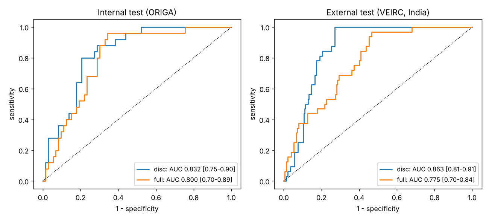

# Nethralaya: glaucoma screening from fundus photographs

A reproducible glaucoma-vs-normal classifier for colour fundus images: data pipeline, training, calibrated evaluation with **external validation**, Grad-CAM, and a privacy-preserving Flask demo. Every design decision is footnoted; the footnotes link to [`NOTES.md`](NOTES.md), and [`docs/INTERVIEW.md`](docs/INTERVIEW.md) condenses them for interview prep.

> **Research prototype, not a medical device.** Glaucoma is diagnosed from intraocular pressure, visual fields and OCT as well as the optic disc. This model can at most help *triage for referral*.[^31]


## Results

EfficientNet-B0 on the optic-disc crop, selected on validation AUC.[^24] The numbers below come from [`reports/metrics.json`](reports/metrics.json). The web app reads the same file, so nothing is hard-coded.[^27]

| | Internal test: ORIGA (Singapore)[^2] | External test: VEIRC (New Delhi)[^3] |
|---|---|---|
| Glaucoma / normal images | 25 / 73 | 32 / 225 |
| **AUC** [95% bootstrap CI][^20] | **0.832** [0.75–0.90] | **0.863** [0.81–0.91] |
| Sensitivity / specificity at threshold[^18] | 92% / 60% | 100% / 25% |
| Sensitivity @ 85% specificity[^17] | 0.44 | 0.62 |
| Calibration error (ECE) before → after Platt[^19] | 0.250 → 0.064 | 0.492 → 0.196 |

**Key findings**[^34]
- **The disc crop beats the full fundus**, by most on the external set: 0.863 vs 0.775 AUC.[^7]
- **Ranking generalises to a new hospital, but the threshold does not.** VEIRC probabilities run higher overall, so the ORIGA-tuned threshold gives 25% specificity there. A new site needs local recalibration.[^34]
- **Context:** Chen et al. (2015) reported AUC 0.831 on ORIGA under a different protocol, so this result is in the same range, not "state of the art".[^2]



Grad-CAM heat-maps are produced live by the app for each upload.[^25] `scripts/evaluate.py` also writes `reports/gradcam_examples.png` locally, but it is git-ignored because it contains ORIGA image crops, which cannot be redistributed.[^33]

## Pipeline

1. Crop the black camera border and pad to a square.[^5]
2. Find the optic disc with a Difference-of-Gaussians blob detector, then crop a square of side 0.40 × fundus diameter around it.[^6]
3. Cache at 256 px.[^12] Feed the network 224 px with ImageNet normalisation.[^9][^10]
4. EfficientNet-B0, ImageNet-pretrained and fine-tuned end to end, outputs a single logit.[^13][^14]
5. Platt scaling turns the logit into a calibrated P(glaucoma).[^19] At or above the validation-chosen threshold the result is "refer".[^18]
6. Grad-CAM shows which regions drove the decision.[^25] Checkpoints are loaded with `weights_only=True`.[^16]

| Stage | Choice | Why (footnote) |
|---|---|---|
| Data | ORIGA 70/15/15 stratified; VEIRC external only | [^2] [^3] [^4] |
| Augmentation | crop/zoom, horizontal flip, ±15° rotation, mild colour jitter; **no vertical flip** | [^11] |
| Imbalance | `BCEWithLogitsLoss(pos_weight≈2.86)` | [^22] |
| Optimiser | AdamW lr 1e-4, wd 0.01, 1-epoch warm-up + cosine, batch 16 | [^23] |
| Regularisation | dropout 0.3, stochastic depth 0.1, early stopping (patience 7) | [^15] [^24] |
| Selection | epoch, learning rate and view chosen on **validation** only | [^24] |
| Serving | one shared inference path; checkpoint stores view, calibration and threshold | [^8] |

## Quick start

```bash
pip install -r requirements.txt

# Run the demo with the committed weights (CPU is fine)
python app/app.py                         # → http://127.0.0.1:5000
curl -F image=@eye.jpg http://127.0.0.1:5000/api/predict   # JSON API

# Run the tests (no dataset needed for the unit tests)
pytest -q
```

The web app:
- **Keeps uploads in memory only.** They are decoded and processed, and results come back as inline images. A test confirms that nothing is written to disk.[^26]
- **Runs with debug mode off**, has a 15 MB upload limit, and checks file types.[^28]
- **Serves a JSON endpoint** (`/api/predict`) for programmatic use.[^29]
- **Has tests:** unit tests for preprocessing and metrics, plus end-to-end tests for the app.[^30]

### Reproduce everything

```bash
python scripts/prepare_data.py            # clone datasets, preprocess, write data/manifest.csv   (~5 min)
python scripts/train.py --view disc       # ~10 min on 2 CPU cores
python scripts/train.py --view full       # ablation (NOTES §7)
python scripts/evaluate.py                # reports/*.json|png and weights/glaucoma_effb0.pt
```

The images are **not** in this repo: both datasets are research-use only. `prepare_data.py` fetches them from public GitHub mirrors.[^2][^3] Seeds are fixed, and versions are pinned in `requirements.txt`.[^21]

## Repository layout

```
nethralaya/            library code
  preprocess.py          border crop, disc localisation, disc crop      §5 §6
  data.py                dataset, transforms, ImageNet normalisation      §9 §10 §11 §12
  model.py               EfficientNet-B0, head init, safe checkpoint I/O  §13 §14 §16
  metrics.py             AUC, sens@spec, threshold, Platt, ECE, bootstrap §17–§20
  gradcam.py             Grad-CAM with tensor hooks, RGB-correct overlay  §25
  inference.py           single inference path for app + evaluation       §8
scripts/               prepare_data.py · train.py · evaluate.py
app/                   Flask app: in-memory uploads, metrics from report  §26 §27 §28
reports/               metrics.json, roc.png, learning curves, recipe_selection.json
weights/               glaucoma_effb0.pt (16 MB, deployed checkpoint)
tests/                 unit + end-to-end tests                            §30
NOTES.md               the footnotes, one section per decision
docs/INTERVIEW.md      pitch, whiteboard diagram, rapid-fire Q&A
```

## Scope and limitations

- **Glaucoma only.** Retinopathy of prematurity was dropped: no credible public dataset was available, and it needs a different camera and population.[^32]
- Small data (25 and 32 test positives), image-level splits, a single seed, and a heuristic disc crop that misses about 2% of images.[^31]

## Licence

Code and trained weights: MIT (see [`LICENSE`](LICENSE)). The datasets keep their own research-only terms.[^33]

## Citations

- Zhang Z. et al. *ORIGA-light: an online retinal fundus image database for glaucoma analysis and research.* EMBC 2010. doi:10.1109/IEMBS.2010.5626137
- Singh A., Dutta M. K. et al. *Image processing based automatic diagnosis of glaucoma using wavelet features of segmented optic disc from fundus image.* CMPB 124:108–120, 2016. doi:10.1016/j.cmpb.2015.10.010
- Issac A., Sarathi M. P., Dutta M. K. *An adaptive threshold based image processing technique for improved glaucoma detection and classification.* CMPB 122(2):229–244, 2015. doi:10.1016/j.cmpb.2015.08.002
- Tan M., Le Q. *EfficientNet: Rethinking Model Scaling for CNNs.* ICML 2019.
- Selvaraju R. R. et al. *Grad-CAM.* ICCV 2017.
- Chen X. et al. *Glaucoma detection based on deep convolutional neural network.* EMBC 2015. doi:10.1109/EMBC.2015.7318462

---

[^2]: [NOTES §2: Training data: ORIGA](NOTES.md#2-training-data-origa)
[^3]: [NOTES §3: External test set: VEIRC (New Delhi)](NOTES.md#3-external-test-set-veirc-new-delhi)
[^4]: [NOTES §4: Train / validation / test split](NOTES.md#4-train--validation--test-split)
[^5]: [NOTES §5: Fundus border crop](NOTES.md#5-fundus-border-crop)
[^6]: [NOTES §6: Optic-disc localisation and crop](NOTES.md#6-optic-disc-localisation-and-crop)
[^7]: [NOTES §7: Two views and the ablation](NOTES.md#7-two-views-and-the-ablation)
[^8]: [NOTES §8: Train/serve parity (one code path)](NOTES.md#8-trainserve-parity-one-code-path)
[^9]: [NOTES §9: Resolution: cache 256, train 224](NOTES.md#9-resolution-cache-256-train-224)
[^10]: [NOTES §10: ImageNet normalisation](NOTES.md#10-imagenet-normalisation)
[^11]: [NOTES §11: Data augmentation](NOTES.md#11-data-augmentation)
[^12]: [NOTES §12: In-memory dataset](NOTES.md#12-in-memory-dataset)
[^13]: [NOTES §13: Backbone: EfficientNet-B0 (ImageNet-pretrained)](NOTES.md#13-backbone-efficientnet-b0-imagenet-pretrained)
[^14]: [NOTES §14: Single-logit head, and an initialisation bug that was caught](NOTES.md#14-single-logit-head-and-an-initialisation-bug-that-was-caught)
[^15]: [NOTES §15: Regularisation: dropout + stochastic depth + weight decay](NOTES.md#15-regularisation-dropout--stochastic-depth--weight-decay)
[^16]: [NOTES §16: Safe checkpoint loading](NOTES.md#16-safe-checkpoint-loading)
[^17]: [NOTES §17: Metrics: why AUC, and sensitivity at 85% specificity](NOTES.md#17-metrics-why-auc-and-sensitivity-at-85-specificity)
[^18]: [NOTES §18: Operating threshold: target 85% sensitivity](NOTES.md#18-operating-threshold-target-85-sensitivity)
[^19]: [NOTES §19: Calibration: Platt scaling, measured by ECE](NOTES.md#19-calibration-platt-scaling-measured-by-ece)
[^20]: [NOTES §20: Bootstrap 95% confidence intervals](NOTES.md#20-bootstrap-95-confidence-intervals)
[^21]: [NOTES §21: Reproducibility](NOTES.md#21-reproducibility)
[^22]: [NOTES §22: Class imbalance: `pos_weight`](NOTES.md#22-class-imbalance-pos_weight)
[^23]: [NOTES §23: Optimiser and schedule: AdamW, warm-up, cosine](NOTES.md#23-optimiser-and-schedule-adamw-warm-up-cosine)
[^24]: [NOTES §24: Model selection and early stopping](NOTES.md#24-model-selection-and-early-stopping)
[^25]: [NOTES §25: Grad-CAM](NOTES.md#25-grad-cam)
[^26]: [NOTES §26: Privacy: uploads never touch the disk](NOTES.md#26-privacy-uploads-never-touch-the-disk)
[^27]: [NOTES §27: Metrics come from the evaluation report, never hard-coded](NOTES.md#27-metrics-come-from-the-evaluation-report-never-hard-coded)
[^28]: [NOTES §28: Web hardening basics](NOTES.md#28-web-hardening-basics)
[^29]: [NOTES §29: JSON API](NOTES.md#29-json-api)
[^30]: [NOTES §30: Tests](NOTES.md#30-tests)
[^31]: [NOTES §31: Limitations and next steps](NOTES.md#31-limitations-and-next-steps-say-these-before-you-are-asked)
[^32]: [NOTES §32: Why ROP was dropped](NOTES.md#32-why-rop-was-dropped)
[^33]: [NOTES §33: Attribution and licences](NOTES.md#33-attribution-and-licences)
[^34]: [NOTES §34: Reading the results](NOTES.md#34-reading-the-results-the-part-to-rehearse)
